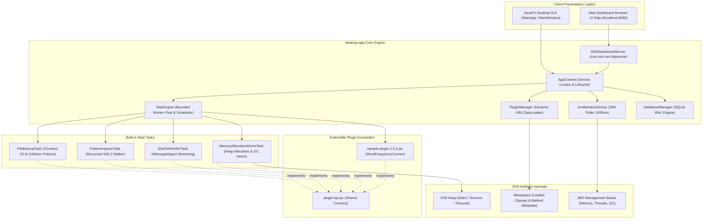
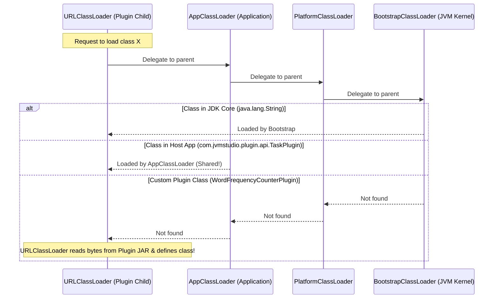
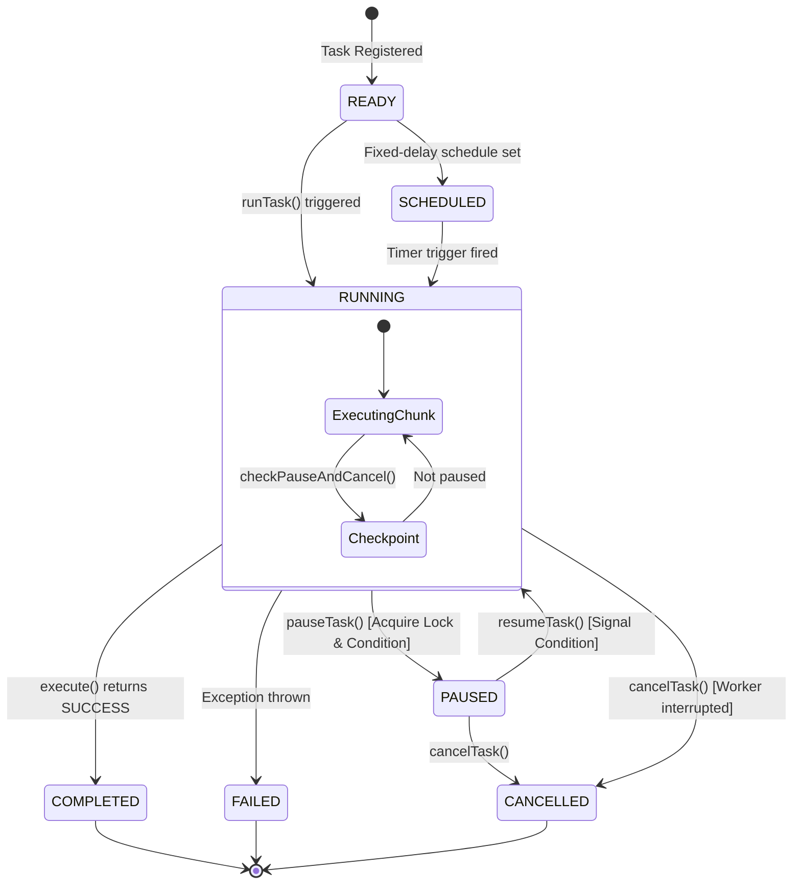
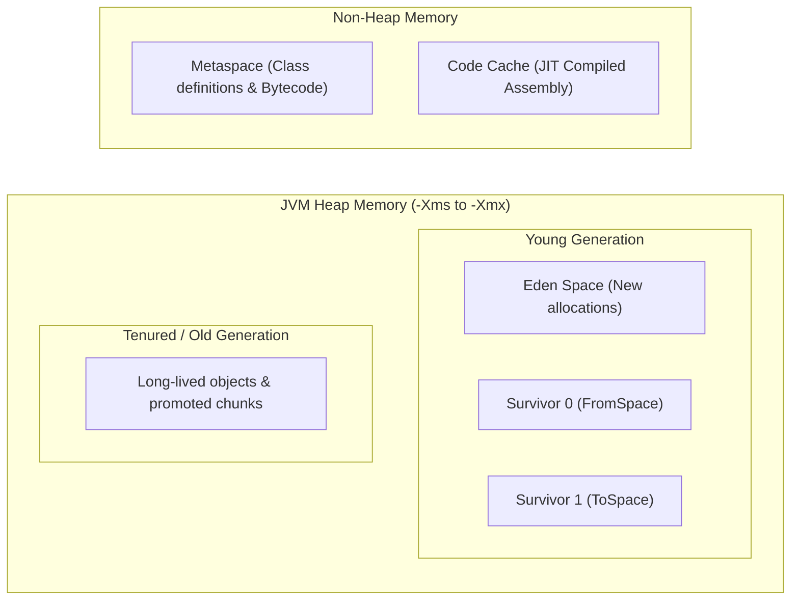

# JVM Studio — Master Technical Guide & Java Deep-Dive Revision Manual

> **Repository:** [https://github.com/DevSars24/jvm-studio](https://github.com/DevSars24/jvm-studio)  
> **Target Runtime:** Java 21 LTS (Oracle HotSpot 64-Bit VM)  
> **Core Architecture:** Multi-Module Maven, Reactive Task Engine, Dynamic Plugin ClassLoader, JMX Telemetry, SQLite WAL Persistence.

---

## Table of Contents

1. [Executive Summary & High-Level Architecture](#1-executive-summary--high-level-architecture)
2. [Complete System Architecture Diagram](#2-complete-system-architecture-diagram)
3. [Module-by-Module Breakdown](#3-module-by-module-breakdown)
4. [Java Revision Concept 1: Dynamic Class Loading & Isolation](#4-java-revision-concept-1-dynamic-class-loading--isolation)
5. [Java Revision Concept 2: Reflection, Annotations & SPI](#5-java-revision-concept-2-reflection-annotations--spi)
6. [Java Revision Concept 3: Concurrency, ThreadPools & Cooperative Interruption](#6-java-revision-concept-3-concurrency-threadpools--cooperative-interruption)
7. [Java Revision Concept 4: JVM Memory Model & Garbage Collection](#7-java-revision-concept-4-jvm-memory-model--garbage-collection)
8. [Java Revision Concept 5: Modern Java NIO.2 File Processing & Safety](#8-java-revision-concept-5-modern-java-nio2-file-processing--safety)
9. [Java Revision Concept 6: SQLite JDBC, WAL Mode & Transactions](#9-java-revision-concept-6-sqlite-jdbc-wal-mode--transactions)
10. [Architectural Showdown: Java vs C++](#10-architectural-showdown-java-vs-c)
11. [Live Web & Desktop Execution Commands](#11-live-web--desktop-execution-commands)
12. [Top Interview Questions Answered from this Project](#12-top-interview-questions-answered-from-this-project)

---

## 1. Executive Summary & High-Level Architecture

**JVM Studio** is an industrial-grade Java 21 desktop and browser application. Unlike tutorial apps with mocked timers or fake progress animations, every element in JVM Studio reflects **actual JVM HotSpot internals**:

- **Real Background Workers:** CPU/IO tasks run on dedicated threads (`ThreadPoolExecutor`) without freezing the UI.
- **Dynamic Hot-Plugging:** External `.jar` files are loaded at runtime using `URLClassLoader` and `ServiceLoader` with zero application restart.
- **Cooperative Concurrency:** Tasks check cooperative pause/resume and cancellation checkpoints using `ReentrantLock` and `Thread.currentThread().isInterrupted()`.
- **Live Memory Telemetry:** Queries real JMX MXBeans (`MemoryMXBean`, `GarbageCollectorMXBean`, `ThreadMXBean`).
- **Local Persistence:** Versioned SQLite database (`~/.jvmstudio/jvmstudio.db`) using Write-Ahead Logging (WAL) and RFC-4180 CSV export.

---

## 2. Complete System Architecture Diagram



---

## 3. Module-by-Module Breakdown

### 1. `plugin-api`
- **Purpose:** Public contract that third-party plugin authors compile against.
- **Key Files:**
  - `TaskPlugin.java`: Core interface defining `execute(TaskContext, Map)`.
  - `TaskContext.java`: Checkpoint API for progress, logs, pause, and cancellation.
  - `@TaskInfo.java`: Runtime-retained metadata annotation (ID, Name, Version, Author, Category).
  - `TaskParameterDescriptor.java`: Dynamic input form generator.
  - `PluginConstants.java`: Strict API compatibility validator (Version `1.0`).
- **Maven Rule:** Pure standard Java 21, zero third-party dependencies.

### 2. `sample-plugin`
- **Purpose:** Demonstrates dynamic JAR loading without classloader pollution.
- **Key Implementation:** `WordFrequencyCounterPlugin.java`
- **Features:** Recursively parses code and text files, calculates word frequencies, extracts top keywords, and reports byte-level progress.
- **Maven Rule:** `plugin-api` dependency is scoped as `<scope>provided</scope>` so API classes are **never duplicated** in the plugin JAR.

### 3. `desktop-app`
- **Purpose:** Host application containing the Task Engine, Persistence, JMX telemetry, Web Server, and JavaFX UI.
- **Key Packages:**
  - `com.jvmstudio.core.model`: Immutable records (`JvmMetricsSnapshot`, `TaskHistoryRecord`, `AppSettings`).
  - `com.jvmstudio.core.db`: SQLite database manager and repositories with migrations.
  - `com.jvmstudio.core.engine`: ThreadPoolExecutor, scheduler, and task state machine.
  - `com.jvmstudio.core.jvm`: Real-time MXBean sampler with bounded history.
  - `com.jvmstudio.core.plugins`: `URLClassLoader` manager and reflection inspector.
  - `com.jvmstudio.core.tasks`: Built-in tasks (Backup, Analyzer, SHA-256, Memory Demo).
  - `com.jvmstudio.web`: Embedded HTTP server serving the browser dashboard.
  - `com.jvmstudio.ui`: Programmatic JavaFX dark dashboard (7 screens).

---

## 4. Java Revision Concept 1: Dynamic Class Loading & Isolation

### The JVM ClassLoader Delegation Hierarchy

In standard Java, class loading follows the **Delegation Model**:



### Key Java Takeaways for Revision:
1. **Delegation Parent Rule:**  
   When creating `URLClassLoader`:
   ```java
   URLClassLoader pluginLoader = new URLClassLoader(
       new URL[]{ jarPath.toUri().toURL() },
       this.getClass().getClassLoader() // Parent is Host AppClassLoader!
   );
   ```
   Because the host classloader is the parent, `com.jvmstudio.plugin.api.TaskPlugin` is resolved by the parent. Both host and plugin see the **exact same Class instance in memory**, preventing `ClassCastException`!
2. **Closing a ClassLoader vs Class Unloading:**
   - Calling `pluginLoader.close()` releases file locks on the `.jar` file.
   - **Important:** Classes loaded in Metaspace are **only** garbage-collected when:
     1. The `ClassLoader` instance itself is unreachable from any GC root.
     2. All `Class` instances loaded by it are unreachable.
     3. All instances of those classes are dereferenced.

---

## 5. Java Revision Concept 2: Reflection, Annotations & SPI

### 1. Service Provider Interface (SPI) via `ServiceLoader`
Instead of hardcoding class names, JVM Studio discovers plugins via Java's native SPI:
- The plugin contains: `META-INF/services/com.jvmstudio.plugin.api.TaskPlugin`
- Inside that file: `com.jvmstudio.plugin.sample.WordFrequencyCounterPlugin`
- The host discovers implementations using:
  ```java
  ServiceLoader<TaskPlugin> sl = ServiceLoader.load(TaskPlugin.class, pluginClassLoader);
  for (TaskPlugin plugin : sl) {
      // Discovered without knowing the class name at compile time!
  }
  ```

### 2. Reflection & Custom Annotations (`@TaskInfo`)
Annotations declared with `@Retention(RetentionPolicy.RUNTIME)` remain embedded in the compiled `.class` bytecode constant pool:
```java
Class<?> clazz = plugin.getClass();
TaskInfo info = clazz.getAnnotation(TaskInfo.class);
if (info != null) {
    String id = info.id();
    String version = info.version();
    String apiVersion = info.apiVersion();
}
```

### Reflection Metadata Inspection in JVM Studio:
Using `java.lang.reflect.Method` and `java.lang.reflect.Modifier`:
```java
for (Method m : clazz.getDeclaredMethods()) {
    String modifiers = Modifier.toString(m.getModifiers());
    String returnType = m.getReturnType().getSimpleName();
    String name = m.getName();
    Class<?>[] params = m.getParameterTypes();
}
```

---

## 6. Java Revision Concept 3: Concurrency, ThreadPools & Cooperative Interruption

### The Task State Machine



### 1. Cooperative Cancellation vs Deprecated `Thread.stop()`
- **Why `Thread.stop()` is deprecated:** It abruptly unlocks all held monitors, leaving objects in corrupted, inconsistent states.
- **The Modern Approach (Used in JVM Studio):**
  1. Engine flags `volatile boolean cancelled = true;` and calls `future.cancel(true)` (which calls `thread.interrupt()`).
  2. The running task periodically checks:
     ```java
     public void checkCancellation() throws InterruptedException {
         if (cancelled || Thread.currentThread().isInterrupted()) {
             throw new InterruptedException("Task cancelled cooperatively.");
         }
     }
     ```
  3. The task catches `InterruptedException`, closes open streams in `finally` blocks, and returns a `CANCELLED` status safely.

### 2. Cooperative Pause & Resume with `ReentrantLock` & `Condition`
```java
private final ReentrantLock pauseLock = new ReentrantLock();
private final Condition unpausedCondition = pauseLock.newCondition();
private volatile boolean paused = false;

public void checkPauseAndCancel() throws InterruptedException {
    checkCancellation();
    if (paused) {
        pauseLock.lockInterruptibly();
        try {
            while (paused && !cancelled) {
                unpausedCondition.await(); // Thread sleeps cooperatively
            }
        } finally {
            pauseLock.unlock();
        }
        checkCancellation();
    }
}

public void resume() {
    pauseLock.lock();
    try {
        paused = false;
        unpausedCondition.signalAll(); // Wakes up worker thread!
    } finally {
        pauseLock.unlock();
    }
}
```

### 3. Documented Overlap Policy
If a scheduled fixed-delay task triggers while the previous execution of that same task is still `RUNNING` or `PAUSED`, the engine **skips** the execution and logs:
```
[OVERLAP POLICY] Task 'X' is currently RUNNING. Overlap policy: execution skipped.
```
This prevents thread starvation and resource pile-ups.

---

## 7. Java Revision Concept 4: JVM Memory Model & Garbage Collection

### HotSpot Generational Heap Layout



### Memory Lifecycle in JVM Studio:
1. **Allocation:** `MemoryAllocationDemoTask` creates `byte[20 * 1024 * 1024]` arrays. They enter **Eden Space**.
2. **GC Roots Reachability:** While references are stored in `List<byte[]> memoryHolders`, the Garbage Collector traces from GC roots (the worker thread's stack frame) and marks them **live**.
3. **Reference Dereferencing:** Calling `memoryHolders.clear()` removes the root pointer. The byte arrays become **unreachable**.
4. **`System.gc()` Behavior:**
   - Calling `System.gc()` is a **hint/request** to the JVM, **not a guaranteed command**.
   - The JVM optimizes GC timing based on ergonomics, allocation pressure, and collector algorithms (G1, ZGC, Parallel GC).

### Real JMX Management Beans Used in the App:
- `ManagementFactory.getMemoryMXBean().getHeapMemoryUsage()`: Returns `used`, `committed`, and `max`.
- `ManagementFactory.getThreadMXBean().getThreadCount()`: Live platform threads.
- `ManagementFactory.getGarbageCollectorMXBeans()`: Returns collectors (e.g. G1 Young/Old), collection counts, and cumulative pause time in milliseconds.

---

## 8. Java Revision Concept 5: Modern Java NIO.2 File Processing & Safety

### 1. Safe Directory Traversal with `Files.walkFileTree`
In `FolderAnalyzerTask` and `FileBackupTask`:
```java
Files.walkFileTree(source, EnumSet.noneOf(FileVisitOption.class), Integer.MAX_VALUE, new SimpleFileVisitor<>() {
    @Override
    public FileVisitResult preVisitDirectory(Path dir, BasicFileAttributes attrs) {
        // PREVENTS RECURSIVE BACKUP LOOPS:
        if (destinationIsInsideSource && dir.startsWith(destination)) {
            return FileVisitResult.SKIP_SUBTREE;
        }
        return FileVisitResult.CONTINUE;
    }
    @Override
    public FileVisitResult visitFile(Path file, BasicFileAttributes attrs) {
        if (attrs.isRegularFile()) {
            filesToProcess.add(file);
        }
        return FileVisitResult.CONTINUE;
    }
    @Override
    public FileVisitResult visitFileFailed(Path file, IOException exc) {
        // Handles permission denied or broken symlinks gracefully!
        return FileVisitResult.CONTINUE;
    }
});
```

### 2. Chunked Streaming for Byte-Level Progress
Rather than copying an entire file in one blocking call (`Files.copy`), `FileBackupTask` reads in 64 KB buffers:
```java
byte[] buffer = new byte[64 * 1024];
int read;
while ((read = in.read(buffer)) != -1) {
    context.checkPauseAndCancel(); // Cooperative checkpoint inside large file!
    out.write(buffer, 0, read);
    bytesCopied += read;
    context.updateProgress(bytesCopied, totalBytes);
}
```

---

## 9. Java Revision Concept 6: SQLite JDBC, WAL Mode & Transactions

### 1. Database Location & Versioning
- Stored in the user home directory: `~/.jvmstudio/jvmstudio.db`.
- Schema versioning via SQLite user pragma:
  ```sql
  PRAGMA user_version;
  -- If version < 1, execute DDL and set PRAGMA user_version = 1;
  ```

### 2. High-Performance Concurrency with WAL Mode
```sql
PRAGMA journal_mode = WAL;
PRAGMA foreign_keys = ON;
```
**Why WAL (Write-Ahead Logging)?**
In traditional rollback journal mode, readers block writers and writers block readers. In **WAL mode**, readers and writers proceed concurrently without database locks!

### 3. Startup Crash Recovery
If the application is force-terminated while tasks were active, `DatabaseManager` runs a startup reconciliation query:
```sql
UPDATE task_history
SET state = 'FAILED',
    summary = 'Execution interrupted by unexpected application restart or shutdown',
    error_message = 'Interrupted: process terminated before task completed'
WHERE state IN ('RUNNING', 'PAUSED');
```
This guarantees tasks are never permanently stuck in `RUNNING` state after a restart.

### 4. RFC-4180 CSV Export Compliance
Fields with commas, quotes, or newlines are quoted, and inner double quotes are doubled (`""`):
```java
public static String escapeCsv(String value) {
    if (value == null) return "";
    if (value.contains(",") || value.contains("\"") || value.contains("\n") || value.contains("\r")) {
        return "\"" + value.replace("\"", "\"\"") + "\"";
    }
    return value;
}
```

---

## 10. Architectural Showdown: Java vs C++

| Feature | Java 21 (JVM HotSpot) | C++20 / C++23 |
| :--- | :--- | :--- |
| **Dynamic Loading** | `URLClassLoader` loads standardized bytecode `.class` on demand. Bytecode verifier ensures memory safety. | `dlopen()` / `LoadLibrary()` loads native binary `.so` / `.dll`. Fragile ABI; requires `extern "C"` to avoid name mangling issues. |
| **Reflection** | Full runtime introspection (`java.lang.reflect`, `@Retention(RUNTIME)`). Inspects classes, methods, and annotations. | No standard language-level reflection. Relies on RTTI (`typeid`) or external code generators (Qt MOC). |
| **Memory Management** | Automatic Generational GC. Eliminates double-free and dangling pointers. Requires `AutoCloseable` for OS resources. | Deterministic RAII and smart pointers (`std::unique_ptr`). Destructors execute immediately at scope exit with zero GC pauses. |
| **Concurrency** | Bounded `ThreadPoolExecutor`, synchronized memory model (JSR-133), Virtual Threads (Project Loom). | `std::thread`, `std::jthread`, `std::mutex`. No standard library thread pool; requires Boost or custom queues. |
| **Portability** | "Write Once, Run Anywhere". Bytecode runs identically across Windows, macOS, and Linux on any compatible JVM. | Compiles to native CPU machine code (x86_64, ARM64). Zero VM overhead, but separate binaries must be built per OS. |

---

## 11. Live Web & Desktop Execution Commands

### 1. Launch the Live Browser Dashboard (Active Now!)
The embedded server runs on port `8080`:
```powershell
# Windows PowerShell
java -cp "desktop-app\target\classes;plugin-api\target\classes;C:\Users\DELL\.m2\repository\org\xerial\sqlite-jdbc\3.45.1.0\sqlite-jdbc-3.45.1.0.jar;C:\Users\DELL\.m2\repository\org\slf4j\slf4j-api\2.0.12\slf4j-api-2.0.12.jar;C:\Users\DELL\.m2\repository\org\slf4j\slf4j-simple\2.0.12\slf4j-simple-2.0.12.jar" com.jvmstudio.web.BrowserDashboardLauncher
```
👉 Open browser: **`http://localhost:8080`**

### 2. Launch the Native JavaFX Desktop Window
```powershell
# Windows PowerShell
.\mvnw.cmd javafx:run -pl desktop-app

# Linux / macOS
./mvnw javafx:run -pl desktop-app
```

### 3. Run the Automated Test Suite (22 Unit Tests)
```powershell
.\mvnw.cmd clean test
```

### 4. Package All Modules into Deployment JARs
```powershell
.\mvnw.cmd clean package
```

---

## 12. Top Interview Questions Answered from this Project

### Q1: What is the difference between `ClassNotFoundException` and `NoClassDefFoundError`?
- **`ClassNotFoundException`:** Checked exception thrown when an application attempts to load a class through its string name (e.g. `Class.forName()`, `ClassLoader.loadClass()`) but no definition could be found on the classpath. Handled in `PluginManager.java`.
- **`NoClassDefFoundError`:** Unchecked error occurring when the class was present at compile time, but is missing from the classpath at runtime during class resolution.

### Q2: Why is `Thread.stop()` deprecated and what is the proper way to cancel a thread?
`Thread.stop()` abruptly unlocks all monitors, leaving data in a corrupted state. The modern standard is **cooperative cancellation**: setting a cancellation flag, calling `thread.interrupt()`, and checking `Thread.currentThread().isInterrupted()` inside the work loop (as implemented in `TaskExecutionContextImpl.java`).

### Q3: Does calling `System.gc()` guarantee that garbage collection will run?
No. The Java Language Specification states that `System.gc()` only suggests that the JVM expend effort toward recycling unused objects. The JVM's ergonomic collector algorithms decide whether and when to trigger collections based on memory pressure.

### Q4: How does `URLClassLoader` prevent `ClassCastException` when communicating with the host?
By passing the host application's classloader as the **parent** classloader. When the plugin references `TaskPlugin`, the child classloader delegates to the parent first. Both the host and the plugin share the identical `TaskPlugin.class` instance.

### Q5: What is the purpose of SQLite WAL mode in multi-threaded Java applications?
WAL (Write-Ahead Logging) allows concurrent read transactions to proceed simultaneously without locking writers, and write transactions to commit without locking readers.
