# 🚀 JVM Studio — Complete Project Explanation

[](https://www.oracle.com/java/)
[](https://openjfx.io/)
[](https://maven.apache.org/)
[](https://sqlite.org/)

> **What is this document?**
> A complete, component-by-component explanation of the JVM Studio project: what each part is, why it exists, how it works, and how the pieces connect, with Mermaid diagrams throughout. It is suitable for study, revision, project viva, and interview preparation.
>
> **Note on scope:** The `plugin-api` and `sample-plugin` sections and the project structure follow the contract described in the project README. The explanations of the packages inside `desktop-app` (db, engine, jvm, plugins, tasks, ui) describe their role and the standard Java design behind them. If your actual class names differ slightly, the concepts remain the same.

> 📖 **Comprehensive Study Guide & Revision Manual:** Check out [**`JVM_STUDIO_MASTER_GUIDE.md`**](file:///c:/Users/DELL/Desktop/java/JVM_STUDIO_MASTER_GUIDE.md) for full architectural explanations, Mermaid diagrams, and deep Java revision concepts (ClassLoaders, Concurrency, Generational GC, NIO.2, JDBC WAL, and Interview Q&As).

---

## 📑 Table of Contents

1. [The Project in One Line](#1-the-project-in-one-line)
2. [Tech Stack: What and Why](#2-tech-stack-what-and-why)
3. [Big-Picture Architecture](#3-big-picture-architecture)
4. [Folder Structure](#4-folder-structure)
5. [Module 1: plugin-api (The Contract)](#5-module-1-plugin-api-the-contract)
6. [Module 2: sample-plugin](#6-module-2-sample-plugin)
7. [Module 3: desktop-app (The Main Application)](#7-module-3-desktop-app-the-main-application)
8. [Dynamic Plugin Loading: The Full Flow](#8-dynamic-plugin-loading-the-full-flow)
9. [ClassLoader Hierarchy and Isolation](#9-classloader-hierarchy-and-isolation)
10. [Task Lifecycle and State Machine](#10-task-lifecycle-and-state-machine)
11. [Cooperative Pause, Resume, and Cancel](#11-cooperative-pause-resume-and-cancel)
12. [Task Engine: Thread Pool and Scheduler](#12-task-engine-thread-pool-and-scheduler)
13. [Built-In Tasks Explained](#13-built-in-tasks-explained)
14. [JVM Monitoring with JMX](#14-jvm-monitoring-with-jmx)
15. [Database Design (SQLite)](#15-database-design-sqlite)
16. [UI Layer (JavaFX)](#16-ui-layer-javafx)
17. [Build System (Maven Multi-Module)](#17-build-system-maven-multi-module)
18. [How to Run the Project](#18-how-to-run-the-project)
19. [Writing a Custom Plugin, Step by Step](#19-writing-a-custom-plugin-step-by-step)
20. [Java vs C++ Learning Lab](#20-java-vs-c-learning-lab)
21. [Five-Minute Live Demo Script](#21-five-minute-live-demo-script)
22. [Native Packaging with jpackage](#22-native-packaging-with-jpackage)
23. [Security Notes](#23-security-notes)
24. [Common Errors and Fixes](#24-common-errors-and-fixes)
25. [Interview and Viva Questions](#25-interview-and-viva-questions)
26. [Glossary](#26-glossary)

---

## 1. The Project in One Line

**JVM Studio is a Java 21 and JavaFX desktop application that demonstrates core Java runtime features (plugin loading, reflection, concurrency, garbage collection, and JMX monitoring) through real, interactive behavior.**

It is not just theory. You click a button and see on screen what is happening inside the JVM.

### The five main features

| # | Feature | Plain explanation |
|---|---------|-------------------|
| 1 | **Dynamic Plugin Loading** | A new `.jar` is loaded while the app is running, with no restart |
| 2 | **Reflection and Annotations** | Classes, methods, and annotations are inspected at runtime |
| 3 | **Concurrent Task Engine** | Tasks run on background threads with pause, resume, cancel, and scheduling |
| 4 | **Live JVM Monitoring** | Real-time charts for heap, threads, and garbage collection |
| 5 | **Java vs C++ Lab** | Design tradeoffs of both languages tied to what the live app just showed |

---

## 2. Tech Stack: What and Why

| Technology | Why it is used |
|------------|----------------|
| **Java 21 (LTS)** | Modern features (records, pattern matching, virtual threads) with long-term support |
| **JavaFX 21** | Desktop GUI toolkit with charts, tables, and CSS styling |
| **Maven and Maven Wrapper** | Build and dependency management; the wrapper means Maven does not need to be installed separately |
| **SQLite 3 (via JDBC)** | Lightweight, file-based database for history, configuration, plugins, and settings |
| **URLClassLoader** | Loads external JAR files at runtime |
| **ServiceLoader** | Discovers plugin implementations using the standard SPI mechanism |
| **JMX MXBeans** | Reads live JVM data (memory, threads, GC) |
| **java.util.concurrent** | Thread pools, scheduling, locks, and conditions |
| **NIO.2 (`java.nio.file`)** | Efficient file and directory traversal and copying |
| **MessageDigest** | Computes SHA-256 hashes |

---

## 3. Big-Picture Architecture

Start with the whole system. Each box is explained in detail in later sections.

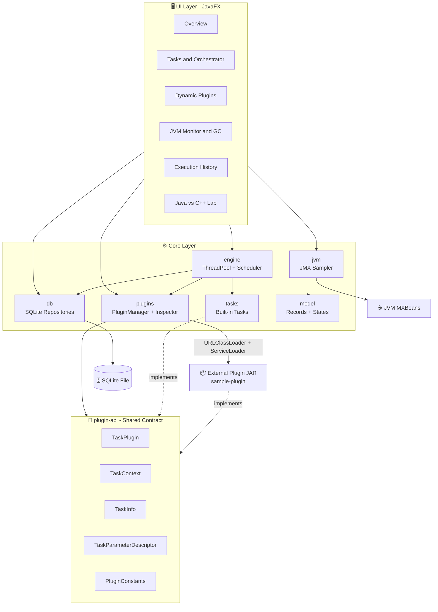

**In short:** the UI only displays things. The core layer does the real work. The `plugin-api` module is an agreement that both the app and every plugin follow, which is why the app can run plugin code it has never seen at compile time.

### Layered view (who talks to whom)

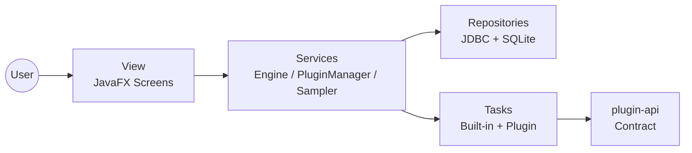

---

## 4. Folder Structure

```
jvm-studio/
├── pom.xml                      # Root (parent) POM that ties all modules together
├── mvnw / mvnw.cmd              # Maven Wrapper scripts
├── plugin-api/                  # Plugin contract (zero external dependencies)
├── sample-plugin/               # A working example plugin JAR
└── desktop-app/                 # The main JavaFX application
```

### Root-level files

| File | Purpose |
|------|---------|
| `pom.xml` | The **parent POM**. Its `<modules>` section lists `plugin-api`, `sample-plugin`, and `desktop-app`. Shared versions (Java 21, JavaFX 21) are defined here |
| `mvnw` | Maven Wrapper script for Linux and macOS |
| `mvnw.cmd` | Maven Wrapper script for Windows |

> **What is the Maven Wrapper?** A small script that downloads the correct Maven version the first time it runs. It avoids "works on my machine" problems caused by different Maven versions.

### Module dependency graph

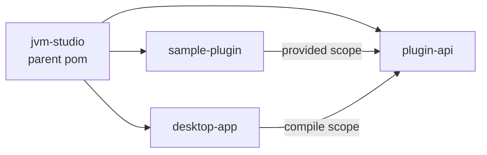

**Important:** for `sample-plugin`, `plugin-api` has `provided` scope, so it is not copied into the plugin JAR. At runtime the app already supplies the API classes. For `desktop-app`, the scope is `compile`.

---

## 5. Module 1: plugin-api (The Contract)

**Path:** `plugin-api/src/main/java/com/jvmstudio/plugin/api/`

This is the smallest module but the most important one. It has no external libraries, so plugin authors carry no extra burden.

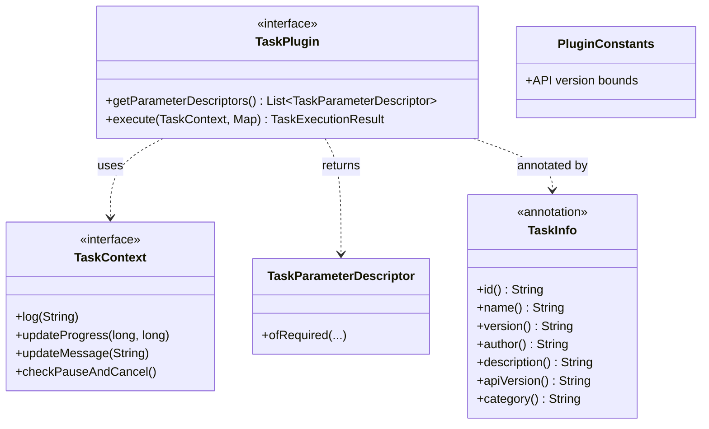

### 5.1 `TaskPlugin.java`: the core execution contract

- An **interface** that every plugin must implement.
- Two main responsibilities:
  1. `getParameterDescriptors()` declares which inputs the plugin needs. The UI uses this to build a form.
  2. `execute(context, parameters)` is where the actual work happens.
- The app knows nothing about a plugin's name or code, only this interface. This is a classic example of **polymorphism and loose coupling**.

### 5.2 `TaskContext.java`: the cooperative control object

This is the plugin's only channel for talking to the app. The plugin does not need to know anything about threads or the UI.

| Method | What it does |
|--------|--------------|
| `log(String)` | Writes a log line (saved to history) |
| `updateProgress(done, total)` | Updates the progress bar |
| `updateMessage(String)` | Updates the status text (for example "Processed item 5") |
| `checkPauseAndCancel()` | A **checkpoint**. If the task is paused, it blocks here. If the task is cancelled, it throws an exception |

### 5.3 `TaskInfo.java`: runtime metadata annotation

```java
@Retention(RetentionPolicy.RUNTIME)   // survives compilation, readable via reflection
@Target(ElementType.TYPE)             // applied to classes only
public @interface TaskInfo { ... }
```

| Field | Meaning |
|-------|---------|
| `id` | Unique identifier (for example `custom-processor`) |
| `name` | Display name shown in the UI |
| `version` | Plugin version |
| `author` | Who built it |
| `description` | Short description |
| `apiVersion` | Which plugin API version it targets (used for compatibility checks) |
| `category` | UI grouping (for example "Data Processing") |

> **Why does this matter?** Without `@Retention(RUNTIME)`, the annotation would be discarded after compilation and reflection could never read it.

### 5.4 `TaskParameterDescriptor.java`: dynamic UI generation

- A plugin declares, for example, "I need an `inputPath` of type FILE".
- The desktop app reads these descriptors and **builds form fields automatically** (text boxes, file choosers, and so on).
- `TaskParameterDescriptor.ofRequired(key, label, type, default, help)` is a factory helper.
- This means no custom UI code is needed for each plugin.

### 5.5 `PluginConstants.java`: API version bounds

- Defines the supported range of the plugin API (`v1.0`).
- When a plugin is loaded, its `@TaskInfo.apiVersion` is compared against this range.
- A plugin built for an incompatible API version is **rejected**.

---

## 6. Module 2: sample-plugin

**Path:** `sample-plugin/src/main/java/com/jvmstudio/plugin/sample/WordFrequencyCounterPlugin.java`

This is a **working example** that shows how a plugin is built.

| Item | Detail |
|------|--------|
| Class | `WordFrequencyCounterPlugin implements TaskPlugin` |
| UI name | **"Text & Code Word Counter"** |
| Purpose | Counts word frequencies in a text or code file |
| Output | `sample-plugin/target/sample-plugin-1.0.0.jar` |

### What is inside a plugin JAR?

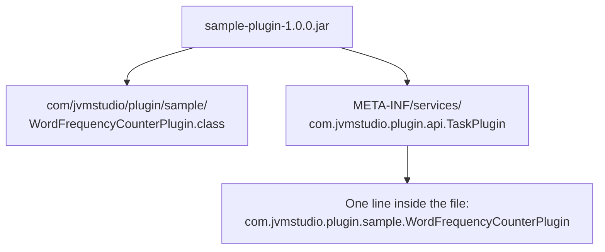

> The `META-INF/services/...` file is what **ServiceLoader** reads. Without it, `ServiceLoader` cannot find the plugin.

---

## 7. Module 3: desktop-app (The Main Application)

**Path:** `desktop-app/src/main/java/com/jvmstudio/`

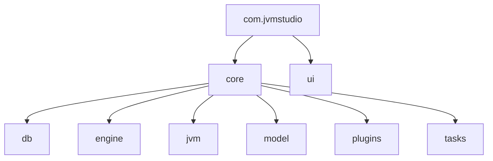

### 7.1 `core/model/`: immutable records and state models

- Uses Java **records**, which are immutable data holders.
- Typically they represent task definitions, execution records, plugin descriptors, JVM snapshots, and the task state enum.
- **Why immutable?** If an object cannot change, there is no risk of race conditions when it is shared across threads.

```java
public record ExecutionRecord(long id, String taskName, String status /* ... */) {}
```

### 7.2 `core/db/`: SQLite persistence

| Repository area | What it stores |
|-----------------|----------------|
| History | The result, timing, logs, and status of every task run |
| Configs | Saved task parameters and configuration |
| Plugins | The list of loaded plugin JARs |
| Settings | Application settings such as theme and defaults |

- Uses JDBC with `PreparedStatement` to prevent SQL injection.
- **WAL mode** (Write-Ahead Logging) lets reads and writes proceed together more smoothly.

### 7.3 `core/engine/`: the execution engine

- A **bounded `ThreadPoolExecutor`** caps the number of threads so the system is not overloaded.
- A **scheduler** repeats tasks with a fixed delay.
- An **overlap policy** decides what happens when a new run is due while the previous one is still running (skip, queue, or allow).
- Pause, resume, and cancel state is managed here.

### 7.4 `core/jvm/`: JMX telemetry sampler

- Samples JVM data roughly once per second:
  - `MemoryMXBean`: heap used, committed, and max
  - `ThreadMXBean`: live thread count
  - `GarbageCollectorMXBean`: GC count and total GC time
- The results are fed to the UI charts.

### 7.5 `core/plugins/`: plugin manager and reflection inspector

- **PluginManager** loads the JAR with `URLClassLoader`, finds plugins with `ServiceLoader`, validates them, and registers them.
- **Reflection inspector** extracts declared methods, annotations, fields, and the classloader hierarchy (used by the "Inspect Reflection Metadata" button).

### 7.6 `core/tasks/`: built-in tasks

Four real tasks (detailed in section 13): Backup, Storage Analyzer, SHA-256 Verifier, and Memory/GC Demo.

### 7.7 `ui/`: programmatic JavaFX dashboard

- The UI is built **in code, not FXML**.
- Sidebar navigation with multiple screens.
- Dark theme via `style.css`.

### 7.8 `resources/style.css`

- The dark theme: background colors, card styling, button hover effects, and table and chart styling.
- Uses JavaFX CSS (properties prefixed with `-fx-`).

---

## 8. Dynamic Plugin Loading: The Full Flow

This is the **most important feature** of the project.

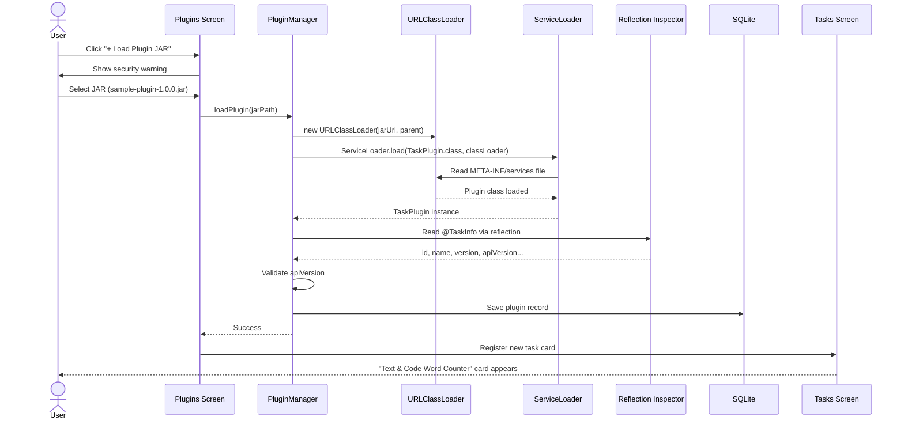

### Step-by-step explanation

1. **The user picks a JAR.** A security notice appears first, because a plugin can contain arbitrary bytecode.
2. **A `URLClassLoader` is created** for that JAR's URL. It acts as a separate "box of classes".
3. **`ServiceLoader` runs.** It reads `META-INF/services/com.jvmstudio.plugin.api.TaskPlugin` and instantiates the class named there.
4. **Reflection reads `@TaskInfo`:** id, name, version, and apiVersion.
5. **Validation:** is the API version compatible, and is the id a duplicate?
6. **Register and persist:** the plugin is added to the in-memory registry and saved to the database.
7. **UI update:** the new card appears on the Tasks screen immediately, with no restart.

### Failure handling

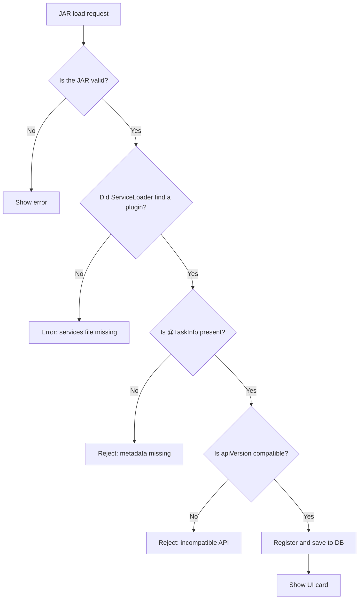

---

## 9. ClassLoader Hierarchy and Isolation

Java loads classes using a **parent-delegation model**.

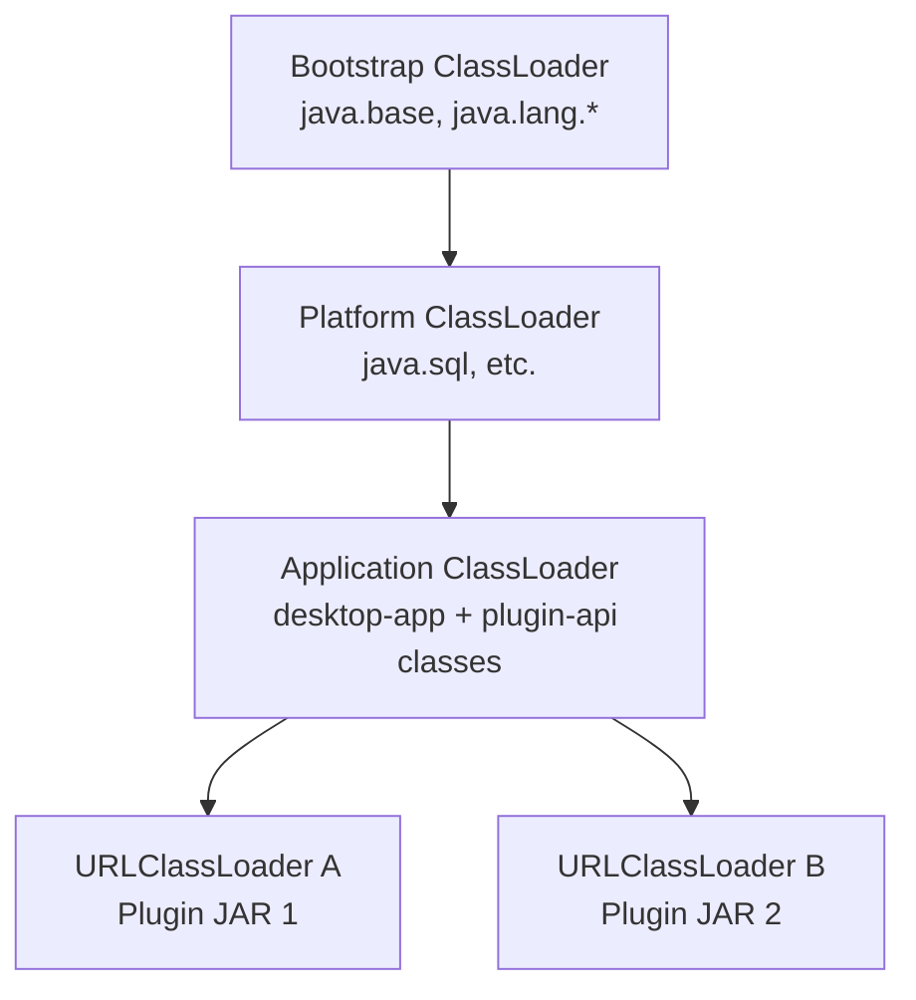

### How parent delegation works

When a plugin asks for the `TaskPlugin` interface:
1. The plugin's loader first asks its **parent**.
2. The parent (Application ClassLoader) already has `TaskPlugin`, so that copy is used.
3. As a result, the plugin and the app see the **same `TaskPlugin` class**.

> **This is why `plugin-api` uses `provided` scope.** If the plugin JAR also contained its own copy of `TaskPlugin.class`, a different classloader could load a separate copy, producing a `ClassCastException` such as "TaskPlugin cannot be cast to TaskPlugin". The two classes look identical but are different at runtime because their loaders differ.

### Benefits of isolation

| Benefit | Explanation |
|---------|-------------|
| Plugin A's classes are invisible to Plugin B | No naming conflicts |
| Unloading is possible | Drop the loader reference, let GC run, and the classes can leave Metaspace |
| Different library versions | Two plugins can use different versions of the same library |

---

## 10. Task Lifecycle and State Machine

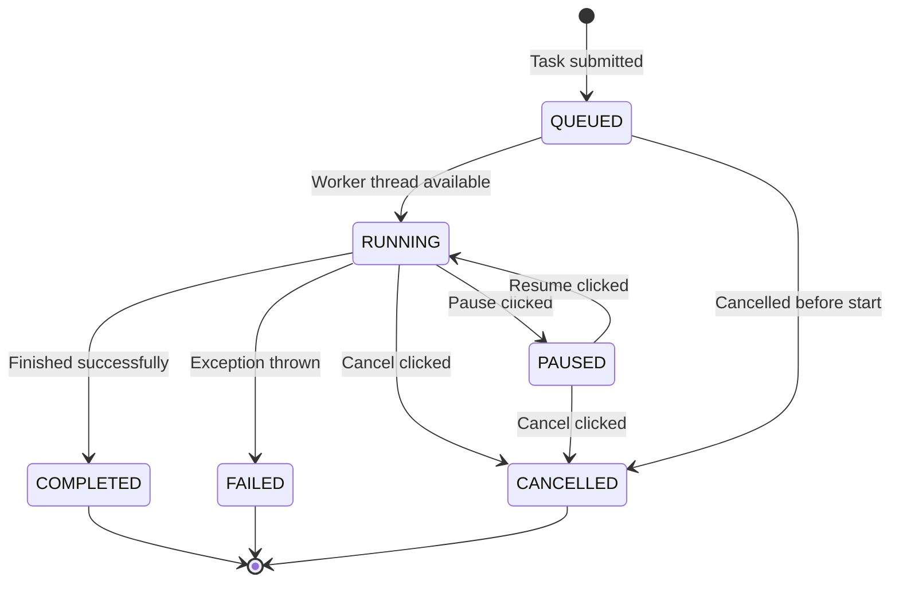

| State | Meaning |
|-------|---------|
| `QUEUED` | Waiting for a free slot in the thread pool |
| `RUNNING` | Executing on a worker thread |
| `PAUSED` | Blocked at a checkpoint, thread idle |
| `COMPLETED` | Finished successfully |
| `FAILED` | Ended with an exception |
| `CANCELLED` | Stopped by the user |

Every final state is written to **Execution History** (SQLite).

---

## 11. Cooperative Pause, Resume, and Cancel

> **In Java you cannot safely force a thread to pause or die.** `Thread.stop()` is deprecated and removed because it was dangerous. Instead, JVM Studio uses **cooperative** control: the task checks a flag at regular intervals.

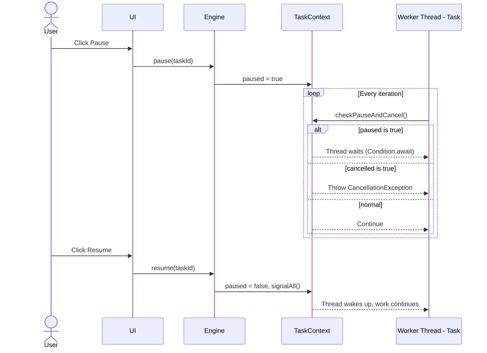

### Conceptual implementation

```java
// The idea behind TaskContext
private final ReentrantLock lock = new ReentrantLock();
private final Condition resumed = lock.newCondition();
private volatile boolean paused;
private volatile boolean cancelled;

public void checkPauseAndCancel() throws InterruptedException {
    lock.lock();
    try {
        while (paused && !cancelled) {
            resumed.await();            // the thread sleeps here
        }
        if (cancelled) throw new CancellationException("Task cancelled");
    } finally {
        lock.unlock();
    }
}
```

### Key concepts

| Concept | Why it matters |
|---------|----------------|
| `volatile` | A change made by one thread is immediately visible to others |
| `ReentrantLock` + `Condition` | Efficient waiting, with no busy-wait and no wasted CPU |
| Checkpoint | The more often a task checks, the faster it responds to pause and cancel |
| Exception for cancel | The stack unwinds, and resources are closed in `finally` blocks |

---

## 12. Task Engine: Thread Pool and Scheduler

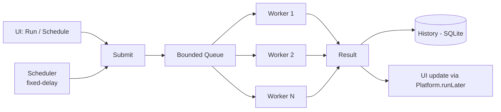

### Why a bounded ThreadPoolExecutor?

| Parameter | Role |
|-----------|------|
| `corePoolSize` | Threads that are always kept alive |
| `maximumPoolSize` | Upper limit on threads |
| `workQueue` (bounded) | A limited queue that prevents memory blowup |
| `RejectedExecutionHandler` | Decides what to do when the queue is full |

### Fixed-delay vs fixed-rate

```mermaid
gantt
    title Fixed-Delay Scheduling (delay starts AFTER each run finishes)
    dateFormat  X
    axisFormat %s
    section Task
    Run 1 :a1, 0, 3
    Delay :d1, 3, 2
    Run 2 :a2, 5, 3
    Delay :d2, 8, 2
    Run 3 :a3, 10, 3
```

- **Fixed-delay:** wait N seconds *after* the previous run finishes, then start the next. Runs never overlap.
- **Fixed-rate:** start every N seconds regardless of how long the run takes, so overlap is possible.
- JVM Studio uses **fixed-delay**, plus an **overlap policy** as a safety net.

### The JavaFX UI thread rule

JavaFX UI can only be updated from the **JavaFX Application Thread**. To update it from a worker thread:

```java
Platform.runLater(() -> progressBar.setProgress(p));
```

This is why the UI stays **fully responsive** while heavy work runs in the background.

---

## 13. Built-In Tasks Explained

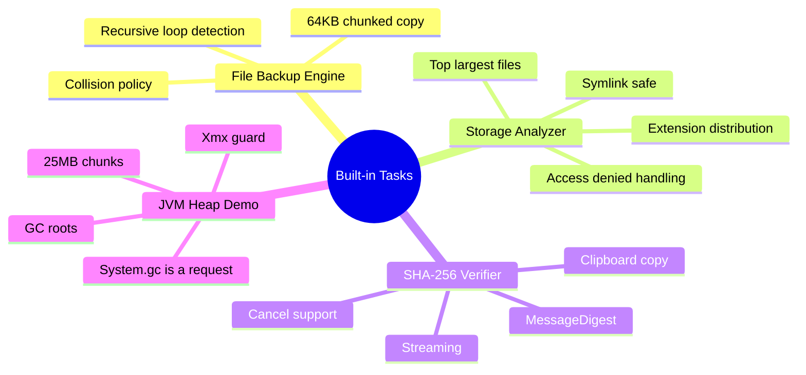

### 13.1 File and Folder Backup Engine

**Purpose:** copy a source folder to a destination.

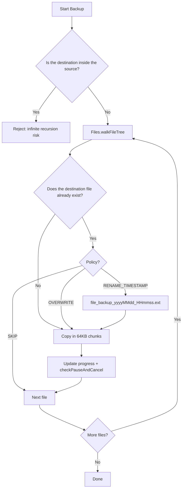

| Concept | Explanation |
|---------|-------------|
| **64 KB buffer** | Files are never loaded fully into memory, so very large files copy safely |
| **Recursive loop detection** | Copying `C:/data` into `C:/data/backup` would make the copy keep copying itself. This is blocked up front |
| **OVERWRITE** | Replace the existing file |
| **SKIP** | Leave the existing file alone |
| **RENAME_TIMESTAMP** | Use a new name such as `report_backup_20261014_091500.txt` |

### 13.2 Disk and Folder Storage Analyzer

**Purpose:** analyze the size and composition of a folder.

| Output | Meaning |
|--------|---------|
| Total bytes | Total size of the folder |
| Directory count | Number of sub-folders |
| Top largest files | The biggest files (typically tracked with a priority queue) |
| Extension distribution | For example `.jpg: 40%, .txt: 10%` |

**Safe traversal:**
- **Symlinks** are not followed, which avoids infinite loops.
- **Access-denied** folders are skipped instead of failing the whole task (`FileVisitor.visitFileFailed`).

### 13.3 SHA-256 Cryptographic Verifier

```java
MessageDigest md = MessageDigest.getInstance("SHA-256");
try (InputStream in = Files.newInputStream(path)) {
    byte[] buf = new byte[8192];
    int n;
    while ((n = in.read(buf)) != -1) {
        context.checkPauseAndCancel();   // cooperative cancellation
        md.update(buf, 0, n);            // streaming hash
    }
}
byte[] hash = md.digest();               // 32 bytes = 64 hex characters
```

- **Streaming** means the whole file never has to fit in RAM.
- The same file always gives the same hash. Changing even one byte produces a completely different hash (the **avalanche effect**). This is used for integrity checks.
- Results appear in a table with a **clipboard copy** button.

### 13.4 JVM Heap Allocation and GC Demo

**Purpose:** safely allocate memory to show how garbage collection behaves.

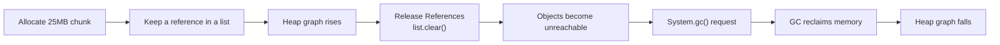

| Concept | Explanation |
|---------|-------------|
| **GC root** | Starting points such as static fields and active thread stack variables. Anything reachable from them stays alive |
| **Reachability** | Objects connected to a root are alive; everything else is garbage |
| **Xmx guard** | Check `Runtime.maxMemory()` before allocating, to avoid `OutOfMemoryError` |
| **`System.gc()`** | Only a **request**, not a guarantee. The JVM may ignore it |

---

## 14. JVM Monitoring with JMX

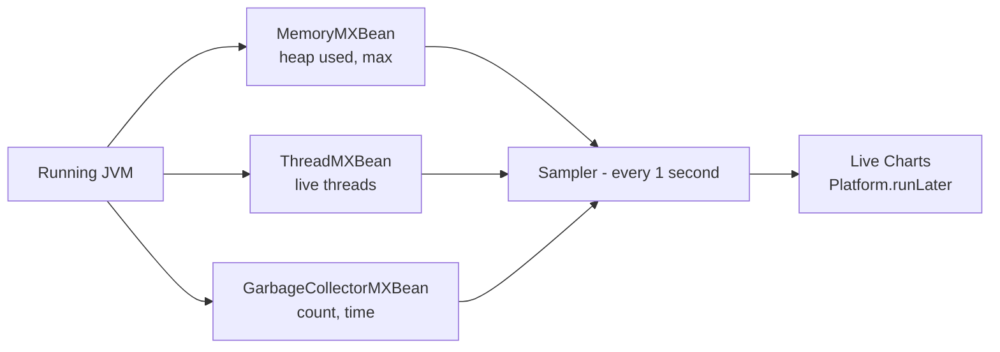

### Code idea

```java
MemoryMXBean mem = ManagementFactory.getMemoryMXBean();
long used = mem.getHeapMemoryUsage().getUsed();

ThreadMXBean th = ManagementFactory.getThreadMXBean();
int threads = th.getThreadCount();

for (GarbageCollectorMXBean gc : ManagementFactory.getGarbageCollectorMXBeans()) {
    long count = gc.getCollectionCount();
    long time  = gc.getCollectionTime();
}
```

### Generational GC at a glance


- **Weak generational hypothesis:** most objects die young, so cleaning the young generation often is cheap.
- **G1** is the default collector. **ZGC** targets ultra-low pause times.

---

## 15. Database Design (SQLite)

> The ER diagram below is **conceptual**, based on the four repository areas in the README. Your actual column names may differ.

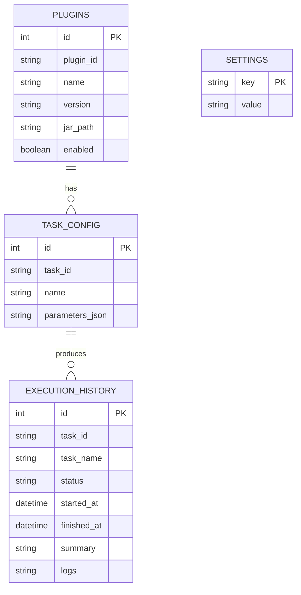

### Why SQLite and WAL?

| Item | Benefit |
|------|---------|
| **SQLite** | Zero configuration, a single file, embedded: ideal for a desktop app |
| **WAL mode** | Writers do not block readers, and it is crash-safe |
| **PreparedStatement** | Protection against SQL injection, plus better performance |
| **try-with-resources** | Connections and statements are closed automatically |

### CSV export (RFC 4180)

- A field containing a comma, quote, or newline is wrapped in `"..."`.
- A `"` inside a field is doubled to `""`.
- Example: `Hello, "World"` becomes `"Hello, ""World"""`.

---

## 16. UI Layer (JavaFX)

### Screens (sidebar navigation)

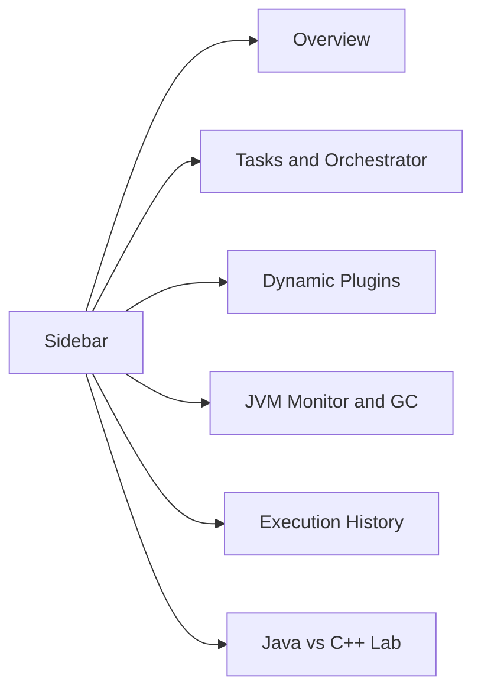

| Screen | What it shows |
|--------|---------------|
| **Overview** | Summary and quick stats |
| **Tasks and Orchestrator** | Task cards (built-in and plugin), run, pause, resume, cancel, schedule, progress, and logs |
| **Dynamic Plugins** | Security notice, Load JAR, Inspect Reflection Metadata, and the loaded plugin list |
| **JVM Monitor and GC** | Live heap and thread charts, Allocate Chunk, Release References, Request GC |
| **Execution History** | Table, status filter, double-click log viewer, Export to CSV |
| **Java vs C++ Lab** | Five learning modules linking live state to theory |

### JavaFX concepts

| Concept | Meaning |
|---------|---------|
| `Application` | The entry class (`MainApp`) |
| `Stage` / `Scene` | The window and the content inside it |
| Scene graph | A tree of nodes (layouts, buttons, charts) |
| Properties and binding | The UI updates automatically when a value changes |
| `Platform.runLater` | Sends work from a background thread to the UI thread |
| CSS | `style.css` provides the dark theme |

### Programmatic UI vs FXML

| Programmatic (used here) | FXML |
|--------------------------|------|
| Everything in Java code | XML file plus a controller |
| Easy to generate dynamic UI (plugin parameters) | Best for static layouts |
| Compile-time type safety | Possible runtime binding errors |

---

## 17. Build System (Maven Multi-Module)

```mermaid
flowchart TD
    A["mvnw clean package"] --> B["Reactor decides build order"]
    B --> C["1. plugin-api"]
    C --> D["2. sample-plugin"]
    C --> E["3. desktop-app"]
    D --> F["sample-plugin-1.0.0.jar"]
    E --> G["desktop-app-1.0.0.jar"]
```

### Maven lifecycle (key phases)

```mermaid
flowchart LR
    V["validate"] --> CO["compile"] --> T["test"] --> PK["package"] --> I["install"] --> DP["deploy"]
```

| Command | What it does |
|---------|--------------|
| `mvnw clean` | Deletes the `target/` folder |
| `mvnw test` | Compiles and runs unit tests |
| `mvnw package` | Builds the JARs |
| `mvnw javafx:run -pl desktop-app` | Runs only the `desktop-app` module |

`-pl` stands for *project list* (which module to run).

### Dependency scopes

| Scope | Compile | Runtime | Packed into JAR |
|-------|:-------:|:-------:|:---------------:|
| `compile` | ✅ | ✅ | ✅ |
| `provided` | ✅ | ❌ (supplied by the host) | ❌ |
| `test` | tests only | tests only | ❌ |

---

## 18. How to Run the Project

### Prerequisites

- **JDK 21 or higher** (check with `java -version`)
- Windows 10/11, macOS, or Linux
- No separate Maven installation (the wrapper handles it)

### Step 1: Run the tests

```powershell
# Windows
.\mvnw.cmd clean test

# Linux / macOS
./mvnw clean test
```

### Step 2: Package everything

```powershell
.\mvnw.cmd clean package
```

Output:
- `desktop-app/target/desktop-app-1.0.0.jar`
- `sample-plugin/target/sample-plugin-1.0.0.jar`

### Step 3: Launch the app

**Option A (recommended for development):**
```powershell
.\mvnw.cmd javafx:run -pl desktop-app
```

**Option B (standalone JAR):**
```powershell
java --module-path "$env:USERPROFILE\.m2\repository\org\openjfx" --add-modules javafx.controls,javafx.graphics -jar desktop-app\target\desktop-app-1.0.0.jar
```

> Since Java 11, JavaFX is no longer bundled with the JDK, which is why `--module-path` and `--add-modules` are needed.

### Loading the sample plugin

```mermaid
flowchart LR
    A["Launch app"] --> B["Sidebar: Dynamic Plugins"]
    B --> C["Read the security notice"]
    C --> D["+ Load Plugin JAR"]
    D --> E["Choose sample-plugin-1.0.0.jar"]
    E --> F["New card appears on Tasks screen"]
```

---

## 19. Writing a Custom Plugin, Step by Step

```mermaid
flowchart TD
    S1["1. Create a Maven project"] --> S2["2. Add plugin-api dependency<br/>scope = provided"]
    S2 --> S3["3. Implement TaskPlugin"]
    S3 --> S4["4. Add @TaskInfo"]
    S4 --> S5["5. Create META-INF/services file"]
    S5 --> S6["6. mvn package"]
    S6 --> S7["7. Load the JAR in JVM Studio"]
```

### Steps 1 and 2: pom.xml

```xml
<dependency>
    <groupId>com.jvmstudio</groupId>
    <artifactId>plugin-api</artifactId>
    <version>1.0.0</version>
    <scope>provided</scope>
</dependency>
```

### Steps 3 and 4: the plugin class

```java
package com.myorg.plugin;

import com.jvmstudio.plugin.api.*;
import java.util.*;

@TaskInfo(
    id = "custom-processor",
    name = "Custom Data Processor",
    version = "1.0.0",
    author = "Engineering Team",
    description = "Processes datasets with progress checkpoints.",
    apiVersion = "1.0",
    category = "Data Processing"
)
public class CustomProcessorPlugin implements TaskPlugin {

    @Override
    public List<TaskParameterDescriptor> getParameterDescriptors() {
        return List.of(
            TaskParameterDescriptor.ofRequired(
                "inputPath", "Input Path", TaskParameterType.FILE, "", "Path to dataset")
        );
    }

    @Override
    public TaskExecutionResult execute(TaskContext context, Map<String, Object> parameters) throws Exception {
        context.log("Processing started...");
        for (int i = 0; i < 100; i++) {
            context.checkPauseAndCancel();          // 👈 cooperative checkpoint
            Thread.sleep(50);
            context.updateProgress(i + 1, 100);
            context.updateMessage("Processed item " + (i + 1));
        }
        return TaskExecutionResult.success(
            100, 1024, "Processed 100 items", Collections.emptyMap(), 5000);
    }
}
```

### Line-by-line meaning

| Line | Meaning |
|------|---------|
| `@TaskInfo(...)` | Tells the app the plugin's metadata |
| `implements TaskPlugin` | Follows the contract |
| `getParameterDescriptors()` | Declares what the generated form looks like |
| `context.checkPauseAndCancel()` | Enables pause and cancel support. **Always include it** |
| `updateProgress(i+1, 100)` | Drives the 0 to 100% progress bar |
| `TaskExecutionResult.success(...)` | The final result object |

### Step 5: service registration (required)

Create the file `src/main/resources/META-INF/services/com.jvmstudio.plugin.api.TaskPlugin`.

Its content is a single line:
```
com.myorg.plugin.CustomProcessorPlugin
```

### Checklist

- [ ] `plugin-api` scope is `provided`
- [ ] The class is `public` and has a no-argument constructor
- [ ] Every `@TaskInfo` field is filled in
- [ ] `apiVersion` is within the supported range
- [ ] The services file name is **exactly** correct
- [ ] The loop calls `checkPauseAndCancel()`

---

## 20. Java vs C++ Learning Lab

| Dimension | Java 21 (JVM HotSpot) | C++20 / C++23 |
|-----------|----------------------|---------------|
| **Dynamic loading** | `URLClassLoader` loads standardized bytecode `.class` files into Metaspace at runtime and isolates modules | `dlopen()` / `LoadLibrary()` loads native `.so` / `.dll`. The ABI is fragile and `extern "C"` is needed to avoid name mangling issues |
| **Reflection and metadata** | First-class runtime reflection (`java.lang.reflect`, `@Retention(RUNTIME)`); full class structure can be inspected | Minimal RTTI (`typeid`, `dynamic_cast`). No standard member enumeration or annotation reflection without macros or generators (such as Qt MOC) |
| **Memory management** | Automatic generational GC (G1, ZGC). Prevents use-after-free and double-free, but does **not** replace resource cleanup (`AutoCloseable`) | Deterministic RAII, destructors, and smart pointers (`std::unique_ptr`). Immediate cleanup with no GC pauses |
| **Concurrency** | Built-in `java.util.concurrent`, ThreadPoolExecutor, a formal memory model (JSR-133), and virtual threads | `std::thread`, `std::jthread`, `std::mutex`. No standard thread pool; needs Boost or custom queues |
| **Portability** | The same bytecode runs on any compatible JVM. JavaFX needs native libraries for the target platform | Compiles to native CPU code (x86_64, ARM64). No VM overhead, but each OS needs its own binary |

```mermaid
flowchart LR
    subgraph JAVA["Java Flow"]
        J1[".java"] --> J2["javac"] --> J3[".class bytecode"] --> J4["JVM + JIT"] --> J5["Machine code"]
    end
    subgraph CPP["C++ Flow"]
        C1[".cpp"] --> C2["Compiler + Linker"] --> C3["Native executable"]
    end
```

### When to choose which

| Situation | Better choice |
|-----------|---------------|
| Enterprise apps, plugin systems, rapid development | Java |
| Game engines, drivers, hard real-time, ultra-low latency | C++ |
| One artifact that runs everywhere | Java |
| Maximum performance per byte and per cycle | C++ |

---

## 21. Five-Minute Live Demo Script

```mermaid
journey
    title 5-Minute Demo Journey
    section Minute 1 - Concurrency
      Start Storage Analyzer: 5: Presenter
      Show Pause and Resume: 5: Presenter
      UI stays responsive: 5: Audience
    section Minute 2 - Plugins
      Load Plugin JAR: 5: Presenter
      Inspect Reflection Metadata: 4: Presenter
      New card on Tasks screen: 5: Audience
    section Minute 3 - JVM Monitor
      Allocate 20MB three times: 5: Presenter
      Release References: 4: Presenter
      Request GC: 4: Presenter
    section Minute 4 - History
      Filter by status: 4: Presenter
      Open log viewer: 4: Presenter
      Export CSV: 5: Presenter
    section Minute 5 - Lab
      Java vs C++ modules: 5: Presenter
```

### Minute 1: Concurrency and responsiveness
1. Open **Tasks and Orchestrator**.
2. Start the **Disk and Folder Storage Analyzer** on a folder.
3. Click **Pause**. The status changes to `PAUSED` and the worker thread idles.
4. Click **Resume**. Execution continues and finishes.
5. Point out that the UI never froze, because the work ran on a background thread.

### Minute 2: Dynamic plugin loading
1. Open **Dynamic Plugins** and show the security warning.
2. Click **+ Load Plugin JAR** and choose `sample-plugin-1.0.0.jar`.
3. Click **Inspect Reflection Metadata** to show methods, annotations, and the classloader hierarchy.
4. Go to **Tasks**. The **"Text & Code Word Counter"** card has appeared with no restart.

### Minute 3: Memory and GC
1. Open **JVM Monitor and GC** (live heap and thread charts).
2. Click **+ Allocate 20 MB Chunk** three times. The heap rises by about 60 MB.
3. Click **Release References**. The GC roots are removed.
4. Click **Request GC**. The collection counter increments and the heap curve drops.
5. Point out that `System.gc()` is only a request.

### Minute 4: History and CSV
1. Open **Execution History** and filter by status (`COMPLETED`, `CANCELLED`).
2. Double-click a row to open the log viewer and summary.
3. Click **Export to CSV** and verify the RFC 4180 output.

### Minute 5: Java vs C++ Lab
1. Open **Java vs C++ Lab**.
2. Walk through the five modules that connect "What you observed" to language design tradeoffs.

---

## 22. Native Packaging with jpackage

```bash
jpackage --input target/ --name JVMStudio \
         --main-jar desktop-app-1.0.0.jar \
         --main-class com.jvmstudio.ui.MainApp \
         --type msi
```

| OS | `--type` |
|----|----------|
| Windows | `msi` / `exe` |
| macOS | `dmg` / `pkg` |
| Linux | `deb` / `rpm` |

```mermaid
flowchart LR
    JAR["App JAR"] --> JP["jpackage"]
    JDK["Host JDK runtime"] --> JP
    JP --> PKG["Native installer"]
```

> **No cross-compiling:** `jpackage` bundles the host operating system's native runtime, so `.msi` must be built on Windows, `.dmg` on macOS, and `.deb` or `.rpm` on Linux.

---

## 23. Security Notes

| Risk | Explanation | Mitigation |
|------|-------------|------------|
| **Arbitrary bytecode execution** | Loading a plugin JAR runs its code with the app's permissions | Load only trusted JARs; the UI shows a warning |
| **Malicious plugins** | Could delete files, make network calls, or steal data | In production: signed JARs, an allow-list, and a separate process or sandbox |
| **SecurityManager** | Deprecated for removal since Java 17 | Use process isolation or containers |
| **SQL injection** | User input could alter queries | `PreparedStatement` |
| **Path traversal** | `../../` could escape an intended folder | Normalize and validate paths |

---

## 24. Common Errors and Fixes

| Error | Cause | Fix |
|-------|-------|-----|
| `Error: JavaFX runtime components are missing` | `--module-path` or `--add-modules` not provided | Use `mvnw javafx:run -pl desktop-app` or pass the flags |
| `UnsupportedClassVersionError` | JDK older than 21 | Install JDK 21 and set `JAVA_HOME` |
| Plugin loads but no card appears | `META-INF/services` file is missing or misnamed | Name it exactly `com.jvmstudio.plugin.api.TaskPlugin` |
| `ClassCastException: TaskPlugin cannot be cast to TaskPlugin` | `plugin-api` was packed into the plugin JAR | Change the scope to `provided` |
| `NoClassDefFoundError` (in a plugin) | The plugin's own dependency is not in its JAR | Build a shaded (fat) JAR, excluding the API |
| Pause does nothing | The task never calls `checkPauseAndCancel()` | Add the checkpoint inside the loop |
| `OutOfMemoryError` | Allocating beyond the heap limit | Raise `-Xmx` or reduce the chunk size |
| UI freezes | Heavy work on the UI thread | Use a worker thread plus `Platform.runLater` |
| `mvnw: Permission denied` (Linux/macOS) | Missing execute permission | Run `chmod +x mvnw` |
| `Database is locked` | Multiple concurrent writers | Use WAL mode, short transactions, and connection reuse |

---

## 25. Interview and Viva Questions

**Q1. What is the difference between `URLClassLoader` and `ServiceLoader`?**
`URLClassLoader` *loads* classes from a JAR or URL. `ServiceLoader` *discovers and instantiates* implementations of an interface using `META-INF/services`. They are used together.

**Q2. What is the parent-delegation model?**
A class-load request goes to the parent loader first. Only if the parent cannot find the class does the child load it itself. This keeps core classes such as `java.lang.String` secure and avoids duplication.

**Q3. Why does `plugin-api` use `provided` scope?**
So the plugin JAR does not contain a duplicate copy of the API. A duplicate would be loaded by a different classloader as a different class, causing a `ClassCastException`.

**Q4. Why is `Thread.stop()` not used?**
It killed a thread mid-operation, released locks, and left objects in inconsistent states. Cooperative cancellation (a flag or interrupt plus checkpoints) is used instead.

**Q5. What does `volatile` do?**
It guarantees visibility and restricts reordering (a happens-before relationship). It does not provide atomicity: `count++` still needs `AtomicInteger` or a lock.

**Q6. Is `System.gc()` guaranteed to run?**
No. It is only a hint. The JVM may ignore it, for example with `-XX:+DisableExplicitGC`.

**Q7. How can Java leak memory even with a GC?**
When objects remain reachable through unintended references (static collections, listeners, `ThreadLocal`, classloader leaks). GC only removes *unreachable* objects.

**Q8. Heap vs stack?**
The stack is per-thread, holds method frames, primitives, and references, and is fast and automatically popped. The heap is shared, holds objects, and is managed by the GC.

**Q9. What is Metaspace?**
The native-memory area that replaced PermGen in Java 8. It stores class metadata.

**Q10. G1 vs ZGC?**
G1 is region-based and balances throughput and pause time (the default). ZGC is concurrent with very low pauses (a sub-millisecond target), suited to large heaps.

**Q11. Fixed-rate vs fixed-delay scheduling?**
Fixed-rate measures start-to-start; fixed-delay measures end-to-start. Fixed-delay avoids overlapping runs.

**Q12. What is a record?**
An immutable data-carrier class (Java 16+). The constructor, accessors, `equals`, `hashCode`, and `toString` are generated automatically.

**Q13. Why `Platform.runLater`?**
JavaFX UI can only be updated safely from the JavaFX Application Thread.

**Q14. What is SQLite WAL?**
Write-Ahead Logging. Changes are written to a log first and merged into the main database later, so readers and a writer can work at the same time.

**Q15. What are the downsides of reflection?**
It is slower, loses compile-time safety, can break encapsulation, and is restricted by the module system (JPMS).

**Q16. Why doesn't Java have RAII?**
The GC manages memory, but non-memory resources (files, sockets) still need `try-with-resources` and `AutoCloseable`.

**Q17. What are virtual threads (Java 21)?**
Lightweight, JVM-managed threads. You can create hundreds of thousands of them, and they suit blocking I/O workloads. CPU-bound work is still best on platform threads.

**Q18. How is a plugin unloaded?**
Drop all references (instances, classes, and the classloader), call `URLClassLoader.close()`, and after a GC cycle the classes can be removed from Metaspace.

---

## 26. Glossary

| Term | Meaning |
|------|---------|
| **JVM** | Java Virtual Machine, the runtime that executes bytecode |
| **Bytecode** | Compiled instructions stored in `.class` files |
| **JIT** | Just-In-Time compiler, which turns hot code into native code |
| **ClassLoader** | Component that loads classes into the JVM |
| **SPI** | Service Provider Interface, a plugin pattern |
| **Reflection** | Inspecting and invoking classes and methods at runtime |
| **Annotation** | Metadata tag on code (such as `@TaskInfo`) |
| **Metaspace** | Native memory area for class metadata |
| **GC root** | A starting point from which reachability is determined |
| **MXBean** | A JMX managed bean that exposes JVM data |
| **RAII** | C++ pattern where resource lifetime equals object lifetime |
| **WAL** | Write-Ahead Logging |
| **Cooperative cancellation** | The task checks for a stop request and exits by itself |
| **Overlap policy** | Rule for a new run when the previous one is still running |
| **Reactor (Maven)** | The component that decides the build order in a multi-module project |
| **jpackage** | JDK tool that builds native installers |

---

### ✅ Final Mind Map (the whole project at a glance)

```mermaid
mindmap
  root((JVM Studio))
    plugin-api
      TaskPlugin
      TaskContext
      TaskInfo
      TaskParameterDescriptor
      PluginConstants
    sample-plugin
      WordFrequencyCounterPlugin
      META-INF services
    desktop-app
      core
        db
        engine
        jvm
        model
        plugins
        tasks
      ui
      style.css
    Concepts
      ClassLoader
      Reflection
      Concurrency
      GC and JMX
      NIO.2
      JDBC WAL
    Tooling
      Maven Wrapper
      jpackage
```

**Happy learning! ☕🚀**
